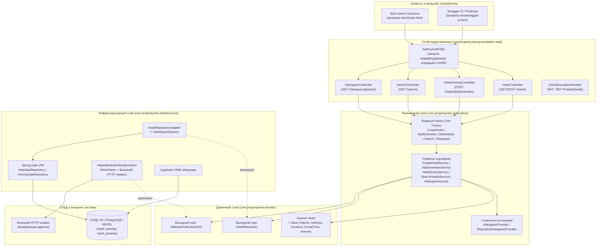

# Property View API — Система управления каталогом отелей

Веб-приложение (RESTful API + веб-клиент каталога и аналитики) для централизованного управления информацией об отелях, их адресными и контактными данными, удобствами (amenities), многокритериального поиска и построения аналитических гистограмм распределения отелей.

## 1. Назначение и целевые пользователи

**Назначение проекта:** предоставление единого стандартизированного интерфейса (HTTP REST API и пользовательского веб-интерфейса) для регистрации отелей, обогащения карточек списком удобств, быстрого поиска объектов размещения по комбинации фильтров и получения агрегированной аналитики по брендам, городам, странам и удобствам.

**Целевые пользователи:**
- **Клиенты и путешественники (Гости):** просматривают каталог отелей, детальные карточки объектов (адрес, контакты, время заезда/выезда, список удобств) и выполняют поиск отелей по городу, стране, бренду и набору удобств через веб-интерфейс или клиентские приложения.
- **Контент-менеджеры и администраторы каталога (Отельеры):** регистрируют новые отели в системе (`POST /hotels`) и поддерживают актуальный перечень удобств каждого отеля (`POST /hotels/{id}/amenities`).
- **Бизнес-аналитики гостиничных сетей:** используют эндпоинты гистограмм (`GET /histogram/{param}`) для оценки географического присутствия брендов и оснащённости отелей удобствами.
- **Внешние партнёрские сервисы и агрегаторы (B2B API-клиенты):** интегрируются с системой по REST API (OpenAPI 3.0) для синхронизации справочника отелей.

## 2. Технологический стек

| Категория | Технология / Инструмент | Назначение |
|---|---|---|
| **Язык программирования** | Java 21 (LTS) | Основной язык разработки (records, pattern matching, Virtual Threads / HttpClient) |
| **Фреймворк приложения** | Spring Boot 4.0.8 | Конфигурация, DI-контейнер, встроенный сервер Tomcat |
| **Веб-слой и валидация** | Spring WebMVC, Jakarta Bean Validation | Обработка REST-запросов, валидация DTO, RFC 7807 `ProblemDetail` |
| **Доступ к данным (ORM)** | Spring Data JPA, Hibernate | Работа с реляционными БД, динамическая фильтрация через `Specification` |
| **СУБД** | H2 (in-memory), PostgreSQL 16, MySQL 8.4 | Основное хранилище данных (переключение через профили Spring) |
| **Миграции БД** | Liquibase (YAML changelog) | Версионирование и управление схемой БД (`ddl-auto=validate`) |
| **Маппинг объектов** | MapStruct 1.6.3 | Кодогенерация мапперов между Entity и Domain Value Objects |
| **Документация и UI** | Springdoc OpenAPI 3.0.3 (Swagger UI) + HTML5/CSS3/JS веб-клиент | Интерактивная документация API и пользовательский интерфейс каталога |
| **Тестирование и качество** | JUnit 5, Mockito, AssertJ, ArchUnit 1.4.1, Playwright, JaCoCo, Checkstyle | Модульное, интеграционное, архитектурное, UI и нагрузочное тестирование |

## 3. Архитектура системы

Проект реализован по принципам **Clean Architecture (Луковая / Гексагональная архитектура)** внутри единого Maven-модуля. Зависимости исходного кода направлены строго внутрь (от `presentation` и `infrastructure` к `application` и `domain`), что автоматически контролируется тестами ArchUnit (`ArchitectureTest`).

### Схема основных компонентов и связей между ними



## 4. Перечень модулей и их ответственность

| Модуль (Пакет) | Основные классы и интерфейсы | Зона ответственности |
|---|---|---|
| `com.propertyview.domain.model` | `Hotel`, `Address`, `Contacts`, `ArrivalTime`, `Amenity`, `HotelOverview`, `HotelSearchCriteria`, `Preconditions` | Ядро бизнес-логики без привязки к фреймворкам: инварианты агрегата `Hotel`, нормализация и регистронезависимая дедупликация удобств (`Amenity`), форматирование адреса, критерии поиска |
| `com.propertyview.domain.port` | `HotelRepository`, `AddressVerificationPort` | Интерфейсы выходных портов (Storage и внешняя HTTP-верификация), от которых зависит прикладной слой |
| `com.propertyview.domain.exception` | `DomainException`, `DomainValidationException`, `HotelNotFoundException`, `UnsupportedHistogramParamException`, `ForbiddenHotelAccessException` | Доменные исключения бизнес-уровня |
| `com.propertyview.application.port.in` | `CreateHotelUseCase`, `AddAmenitiesUseCase`, `GetHotelUseCase`, `GetHotelsUseCase`, `SearchHotelsUseCase`, `GetHistogramUseCase` | Входные порты (интерфейсы сценариев использования системы) |
| `com.propertyview.application.service` | `CreateHotelService`, `AddAmenitiesService`, `HotelQueryService`, `SearchHotelsService`, `HistogramService` | Оркестрация бизнес-сценариев, преобразование доменных моделей в прикладные DTO (`HotelSummary`, `HotelDetails`), логирование операций |
| `com.propertyview.application.histogram` | `HistogramParam`, `HistogramProvider`, `RepositoryHistogramProvider` | Реализация паттерна **Strategy** для расчёта гистограмм по параметрам `brand`, `city`, `country`, `amenities` |
| `com.propertyview.infrastructure.persistence` | `HotelRepositoryAdapter`, `HotelSpecifications`, `HotelEntity`, `AmenityEntity`, `HotelJpaRepository`, `AmenityJpaRepository`, `HotelPersistenceMapper` | Адаптер реляционной БД: JPA-сущности, динамические спецификации поиска (`Specification`), агрегирующие JPQL-запросы без проблемы N+1, мапперы MapStruct |
| `com.propertyview.infrastructure.client` | `HttpAddressVerificationClient` | HTTP-клиент интеграции с внешним сервисом проверки адресов (тестируется через HTTP-заглушки) |
| `com.propertyview.infrastructure.config` | `UseCaseConfig`, `OpenApiConfig` | Регистрация бинов Use Case (без загрязнения прикладного слоя Spring-аннотациями) и настройка OpenAPI/Swagger |
| `com.propertyview.presentation.web` | `HotelController`, `HotelAmenityController`, `SearchController`, `HistogramController`, `GlobalExceptionHandler`, `HotelWebMapper`, Request/Response DTO | Приём HTTP-запросов, декларативная валидация (`@Valid`), формирование ответов и ошибок по стандарту RFC 7807 (`application/problem+json`) |

## 5. Точки интеграции

1. **Реляционные СУБД (H2 / PostgreSQL / MySQL):**
   - Подключение через JDBC и пул соединений HikariCP.
   - Управление схемой данных исключительно через Liquibase (`src/main/resources/db/changelog/db.changelog-master.yaml`), таблицы `hotel`, `amenity`, `hotel_amenity`.
   - Поддержка переключения СУБД профилями конфигурации (`default`/`local`/`demo` — H2, `postgres` — PostgreSQL на порту `5433`, `mysql` — MySQL на порту `3307`).
2. **Внешний HTTP-сервис верификации адресов (`AddressVerificationPort` / `HttpAddressVerificationClient`):**
   - Интеграция по протоколу HTTP/JSON через Spring `RestClient` для проверки корректности почтового адреса и страны при необходимости внешней верификации.
3. **OpenAPI 3.0 / Swagger UI:**
   - Автоматическая генерация контракта API по адресу `/property-view/v3/api-docs` и интерактивная консоль `/property-view/swagger-ui.html`.
4. **Веб-клиент каталога (Static Web UI):**
   - Клиентское одностраничное веб-приложение (`src/main/resources/static/index.html`), взаимодействующее с backend по REST API (`/property-view/hotels`, `/property-view/search`, `/property-view/histogram/{param}`).

## 6. Сводка API-эндпоинтов

Все маршруты имеют общий префикс `/property-view` и работают на порту `8092`:

| Метод | Маршрут | Описание | Коды ответов |
|---|---|---|---|
| `GET` | `/property-view/hotels` | Получение краткого списка всех отелей | `200 OK` |
| `GET` | `/property-view/hotels/{id}` | Получение полной карточки отеля по его `id` | `200 OK`, `400 Bad Request`, `404 Not Found` |
| `POST` | `/property-view/hotels` | Создание нового отеля (возвращает `Location` и краткую карточку) | `201 Created`, `400 Bad Request`, `401 Unauthorized` |
| `POST` | `/property-view/hotels/{id}/amenities` | Добавление списка удобств к отелю | `200 OK`, `400 Bad Request`, `401/403`, `404 Not Found` |
| `GET` | `/property-view/search` | Поиск отелей по `name`, `brand`, `city`, `country`, `amenities` | `200 OK` |
| `GET` | `/property-view/histogram/{param}` | Гистограмма количества отелей по `brand`, `city`, `country`, `amenities` | `200 OK`, `400 Bad Request` |

## 7. Инструкция по сборке, запуску и тестированию

### Предварительные требования
- **JDK 21**
- **Maven 3.9+** (либо встроенный скрипт `./mvnw`)
- **Docker & Docker Compose** (опционально — для запуска с PostgreSQL или MySQL)

### Сборка и запуск приложения (H2 in-memory по умолчанию)
```bash
./mvnw clean package
./mvnw spring-boot:run
```
После запуска доступны:
- **Веб-интерфейс каталога отелей:** `http://localhost:8092/property-view/index.html`
- **Swagger UI:** `http://localhost:8092/property-view/swagger-ui.html`
- **OpenAPI JSON:** `http://localhost:8092/property-view/v3/api-docs`

### Запуск с демонстрационными данными (профиль `demo`)
```bash
./mvnw spring-boot:run -Dspring-boot.run.profiles=demo
```

### Переключение на PostgreSQL или MySQL (через Docker Compose)
```bash
# PostgreSQL (порт 5433)
docker compose --profile postgres up -d --wait
./mvnw spring-boot:run -Ppostgres -Dspring-boot.run.profiles=postgres

# MySQL (порт 3307)
docker compose --profile mysql up -d --wait
./mvnw spring-boot:run -Pmysql -Dspring-boot.run.profiles=mysql
```

### Запуск тестов, проверка покрытия (JaCoCo) и статического анализа (Checkstyle)
```bash
# Полный цикл сборки, тестов, проверки покрытия (>=70%) и линтера
./mvnw clean verify

# Быстрый smoke-тест по работающему приложению
bash scripts/smoke.sh
```
Отчёт о покрытии кода тестами генерируется в `target/site/jacoco/index.html`.

## 8. Документация проекта и результаты лабораторных работ
- [Архитектурное решение ADR-001](docs/adr/0001-architecture-and-stack.md)
- [Спецификация требований, верификация и диаграммы (Задание 1)](docs/SRS.md)
- [Реестр обнаруженных дефектов и несоответствий (Задания 1, 3)](ISSUES.md)
- [План тестирования (Задание 3)](docs/TEST_PLAN.md)
- [Чек-лист проверок по модулям (Задание 3)](docs/CHECKLIST.md)
- [Каталог тест-кейсов и результаты прогона (Задание 3)](docs/TEST_CASES.md)
- [Отчёт по верстке, кроссбраузерности, Postman API, безопасности и UI-автотестам (Задание 4)](docs/LAB4_REPORT.md)
- [План и отчёт нагрузочного тестирования, линтер (Задание 5)](docs/LOAD_TEST_PLAN.md) / [Отчёт нагрузочного тестирования](docs/LOAD_TEST_REPORT.md)
- [Матрица трассируемости требований и тестов (Задание 5)](docs/TRACEABILITY_MATRIX.md)
