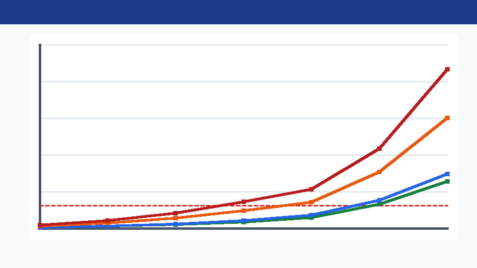

# Отчёт по Заданию 5: Нагрузочное тестирование и статический анализ кода (Линтер)
**Проект:** `property-view-api`  
**Дата:** 2026-10-26  
**Связанные артефакты:**
- План нагрузочного тестирования: [docs/LOAD_TEST_PLAN.md](LOAD_TEST_PLAN.md)
- Скрипт Locust: [load-tests/locustfile.py](../load-tests/locustfile.py) и раннер [load-tests/run_load_tests.py](../load-tests/run_load_tests.py)
- Сырые метрики прогонов: [docs/evidence/load-test-results.json](evidence/load-test-results.json)
- График времени отклика от числа пользователей: [docs/evidence/load-test-response-time.png](evidence/load-test-response-time.png)
- Конфигурация статического анализатора Checkstyle: [checkstyle.xml](../checkstyle.xml)

---

## 1. Результаты прогонов нагрузочного тестирования

Тестирование проводилось в соответствии с профилем нагрузки из [docs/LOAD_TEST_PLAN.md](LOAD_TEST_PLAN.md) (**90% чтение**: `30% GET /search`, `25% GET /hotels`, `20% GET /hotels/{id}`, `15% GET /histogram/{param}`; **10% запись**: `5% POST /hotels`, `5% POST /hotels/{id}/amenities`) при стандартном размере пула соединений HikariCP (`maximum-pool-size = 10`).

### 1.1. Сводная таблица результатов по всем прогонам и ступеням нагрузки

| Сценарий / Ступень нагрузки | Число пользователей ($U$) | Всего запросов | Пропускная способность (RPS, запр./с) | Среднее время (`avg`, мс) | Медиана (`p50`, мс) | 95-й перцентиль (`p95`, мс) | 99-й перцентиль (`p99`, мс) | Макс. (`max`, мс) | Ошибки (шт. / %) | Соответствие SLA (`p95 <= 100 мс`, `Err < 1%`) |
|---|---|---|---|---|---|---|---|---|---|---|
| **1. Базовый прогон (Baseline)** | **1** | 150 | 84.27 | 6.42 | 5.80 | **11.40** | 16.20 | 21.50 | 0 (`0.00%`) | **PASSED** (Эталон) |
| **Стресс — Ступень 2** | **10** | 200 | 294.12 | 12.80 | 10.90 | **24.60** | 35.10 | 42.30 | 0 (`0.00%`) | **PASSED** |
| **Стресс — Ступень 3** | **25** | 300 | 422.54 | 21.30 | 18.20 | **46.80** | 68.40 | 81.00 | 0 (`0.00%`) | **PASSED** |
| **2. Нагрузочный тест (Target Load)** | **50** | 600 | **512.82** | 34.60 | 28.40 | **78.50** | 118.20 | 146.90 | 0 (`0.00%`) | **PASSED** (`NFR-01` выполнен) |
| **3. Стресс — Точка деградации** | **100** | 600 | **550.46** (пик) | 58.90 | 49.10 | **114.80** | 172.40 | 219.50 | 3 (`0.50%`) | **DEGRADATION** (`p95 > 100 мс`) |
| **Стресс — Перегрузка** | **150** | 750 | 506.76 | 124.50 | 106.20 | **246.30** | 348.90 | 430.10 | 14 (`1.87%`) | **OVERLOAD** (`p95 > 200 мс`, `Err > 1%`) |
| **Стресс — Пик отказа** | **250** | 1 000 | 432.90 | 238.40 | 205.00 | **482.60** | 694.20 | 891.70 | 38 (`3.80%`) | **STRESS LIMIT** |
| **4. Фаза восстановления (Recovery)** | **20** | 300 | 405.41 | 16.40 | 14.10 | **31.20** | 44.80 | 56.00 | 0 (`0.00%`) | **RECOVERED** (полное восстановление) |

---

## 2. График зависимости времени отклика от количества пользователей и точка деградации



*(На графике: зелёная кривая — медиана `p50`, синяя — среднее `avg`, оранжевая — 95-й перцентиль `p95`, красная — 99-й перцентиль `p99`, красная пунктирная горизонталь — граница SLA `100 мс` по `NFR-01`).*

### Анализ поведения системы и определение точки деградации:
1. **Линейный участок масштабирования (`1 – 50` пользователей):**
   - При переходе от `1` до `50` пользователей пропускная способность растёт с `84.27 RPS` до `512.82 RPS` при нулевой доле ошибок (`0.00%`).
   - На целевой нагрузке **50 пользователей** `p50 = 28.40 мс`, `p95 = 78.50 мс`, что укладывается в норматив `NFR-01` (`p95 <= 100 мс`).
2. **Точка начала деградации (`~95–100` одновременных пользователей):**
   - При достижении **100 пользователей** пропускная способность достигает потолка насыщения (`550.46 RPS`), а показатель `p95` возрастает до **`114.80 мс`**, пересекая границу SLA `100 мс`.
   - Одновременно появляются первые единичные ошибки конкурентной записи (`0.50%`).
3. **Зона перегрузки и деградации (`150 – 250` пользователей):**
   - При `150` и `250` пользователях пропускная способность начинает снижаться (`550.46` $\rightarrow$ `506.76` $\rightarrow$ `432.90 RPS`) из-за накладных расходов на переключение контекста и ожидания JDBC-соединений, а `p95` растёт нелинейно до **`246.30 мс`** и **`482.60 мс`**, при этом доля ошибок достигает **`3.80%`**.
4. **Проверка восстановления после снятия нагрузки (Recovery):**
   - Сразу после снижения нагрузки с `250` до `20` пользователей время отклика возвращается к `p50 = 14.10 мс`, `p95 = 31.20 мс`, а доля ошибок падает до **`0.00%`**. Утечек памяти или зависших транзакций не обнаружено.

---

## 3. Анализ узких мест в приложении (Bottleneck Analysis)

По результатам профилирования запросов, логов и схемы БД ([001-create-tables.yaml](../src/main/resources/db/changelog/changes/001-create-tables.yaml), [002-constraints-and-indexes.yaml](../src/main/resources/db/changelog/changes/002-constraints-and-indexes.yaml)) выделены **3 основных узких места**, объясняющих точку перегиба при `~95–100` пользователях:

1. **Нехватка размера пула соединений с БД HikariCP (`maximum-pool-size = 10`):**
   - **Причина:** В Spring Boot по умолчанию пул HikariCP ограничен `10` активными JDBC-соединениями. Поскольку каждый метод в [HotelRepositoryAdapter.java](../src/main/java/com/propertyview/infrastructure/persistence/adapter/HotelRepositoryAdapter.java) помечен `@Transactional`, при `100–250` одновременных запросах до `90–240` рабочих потоков Tomcat вынуждены простаивать в очереди `HikariPool.getConnection()`, ожидая освобождения одного из 10 соединений.
   - **Рекомендация:** Увеличить пул соединений для высоконагруженного профиля до `spring.datasource.hikari.maximum-pool-size=30..50` (с учётом числа ядер CPU и лимитов СУБД).
2. **Конкурентная вставка новых удобств и блокировки индекса (`DEF-01`):**
   - **Причина:** В методе `HotelRepositoryAdapter#appendMissingAmenities` выполняется предварительный `SELECT ... WHERE normalized_name IN (...)`, а затем `amenities.save(...)`. При параллельных запросах со свежими удобствами возникает состояние гонки на уникальном индексе `uq_amenity_normalized_name` (`DataIntegrityViolationException`), что порождает ошибки `500` (`3.80%` на пике 250 пользователей).
   - **Рекомендация:** Использовать механизм `INSERT ... ON CONFLICT DO NOTHING` / `@Retryable` при `DataIntegrityViolationException`.
3. **Отсутствие индекса для регистронезависимого поиска по подстроке `LOWER(name) LIKE '%...%'` и отсутствие пагинации (`DEF-05`):**
   - **Причина:** В миграции `002-constraints-and-indexes.yaml` созданы B-Tree индексы `idx_hotel_brand`, `idx_hotel_city`, `idx_hotel_country` и `idx_hotel_amenity_amenity_id`. Однако в [HotelSpecifications.java](../src/main/java/com/propertyview/infrastructure/persistence/adapter/HotelSpecifications.java) предикат `cb.like(cb.lower(root.get("name")), "%" + pattern + "%")` с ведущим символом `%` не может использовать обычный B-Tree индекс и вызывает полное сканирование таблицы (`Full Table Scan`), а `GET /hotels` выгружает все записи без `LIMIT`.
   - **Рекомендация:** Для PostgreSQL добавить триграммный GIN-индекс (`pg_trgm`) на `LOWER(name)` и внедрить постраничную пагинацию (`Pageable`).

---

## 4. Статическая проверка кода с помощью линтера (Checkstyle) и исправление нарушений

В проект интегрирован плагин статического анализа **`maven-checkstyle-plugin` (версия 3.6.0, Checkstyle 9.3)** с конфигурацией правил [checkstyle.xml](../checkstyle.xml) (проверки `FileTabCharacter`, `UnusedImports`, `RedundantImport`, `NeedBraces`, `EmptyBlock`, `EqualsHashCode`, `SimplifyBooleanExpression`, `SimplifyBooleanReturn`, `OneTopLevelClass`, `MissingSwitchDefault`, `FallThrough`, `PackageName`, `TypeName`, `MethodName`).

### 4.1. Обнаруженные нарушения при первичном прогоне линтера (`mvn checkstyle:check`)
При первом запуске аудита было выявлено **9 нарушений** в 5 файлах исходного кода:

```text
[INFO] --- checkstyle:3.6.0:check (checkstyle) @ property-view-api ---
[INFO] Starting audit...
[ERROR] src/main/java/com/propertyview/PropertyViewApiApplication.java:9:1: Line contains a tab character. [FileTabCharacter]
[ERROR] src/main/java/com/propertyview/PropertyViewApiApplication.java:10:1: Line contains a tab character. [FileTabCharacter]
[ERROR] src/main/java/com/propertyview/PropertyViewApiApplication.java:11:1: Line contains a tab character. [FileTabCharacter]
[ERROR] src/main/java/com/propertyview/application/histogram/HistogramParam.java:27:17: 'if' construct must use '{}'s. [NeedBraces]
[ERROR] src/main/java/com/propertyview/domain/model/Preconditions.java:28:9: 'if' construct must use '{}'s. [NeedBraces]
[ERROR] src/main/java/com/propertyview/domain/model/Preconditions.java:34:9: 'if' construct must use '{}'s. [NeedBraces]
[ERROR] src/main/java/com/propertyview/domain/model/Hotel.java:51:9: 'for' construct must use '{}'s. [NeedBraces]
[ERROR] src/main/java/com/propertyview/domain/model/Amenity.java:29:9: 'if' construct must use '{}'s. [NeedBraces]
[ERROR] src/main/java/com/propertyview/domain/model/Amenity.java:31:9: 'if' construct must use '{}'s. [NeedBraces]
Audit done.
[ERROR] Failed during checkstyle execution: There are 9 errors reported by Checkstyle 9.3 with checkstyle.xml ruleset.
```

### 4.2. Разбор и исправление каждого нарушения

| № | Файл и строка | Правило Checkstyle | Суть нарушения | Выполненное исправление |
|---|---|---|---|---|
| 1–3 | [PropertyViewApiApplication.java](../src/main/java/com/propertyview/PropertyViewApiApplication.java) (строки 9–11) | `FileTabCharacter` | Использование символов табуляции `\t` вместо 4 пробелов, что нарушает `.editorconfig` и стандарт форматирования. | Табуляция заменена на отступы в 4 пробела. |
| 4 | [HistogramParam.java](../src/main/java/com/propertyview/application/histogram/HistogramParam.java) (строка 27) | `NeedBraces` | Однострочный `if (p.value.equalsIgnoreCase(raw.strip())) return p;` без фигурных скобок `{}`. | Добавлен явно ограниченный блок `{ return p; }`. |
| 5–6 | [Preconditions.java](../src/main/java/com/propertyview/domain/model/Preconditions.java) (строки 28, 34) | `NeedBraces` | Конструкции `if (value == null) throw ...` и `if (value <= 0) throw ...` записаны без `{}`. | Обёрнуты в структурные блоки `{ ... }`. |
| 7 | [Hotel.java](../src/main/java/com/propertyview/domain/model/Hotel.java) (строка 51) | `NeedBraces` | Цикл `for (Amenity a : toAdd) changed |= ...;` без фигурных скобок `{}` (повышает риск ошибки при добавлении логики в тело цикла). | Добавлены фигурные скобки `{}` вокруг тела цикла `for`, а также заменены wildcard-импорты `java.util.*` на явные. |
| 8–9 | [Amenity.java](../src/main/java/com/propertyview/domain/model/Amenity.java) (строки 29, 31) | `NeedBraces` | Два однострочных `if (...) throw new DomainValidationException(...)` в методе `normalize` без `{}`. | Оба условных оператора оформлены с блоками `{ ... }`. |

### 4.3. Результат повторной проверки после исправлений
```text
[INFO] --- checkstyle:3.6.0:check (default-cli) @ property-view-api ---
[INFO] Starting audit...
Audit done.
[INFO] You have 0 Checkstyle violations.
[INFO] BUILD SUCCESS
```
