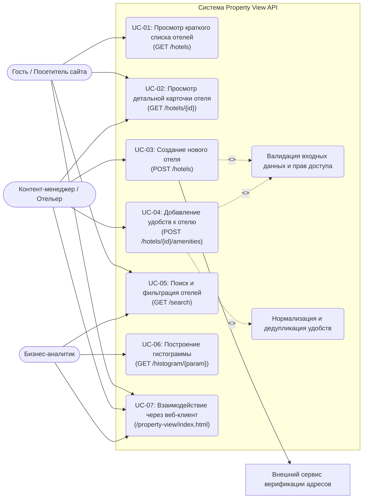
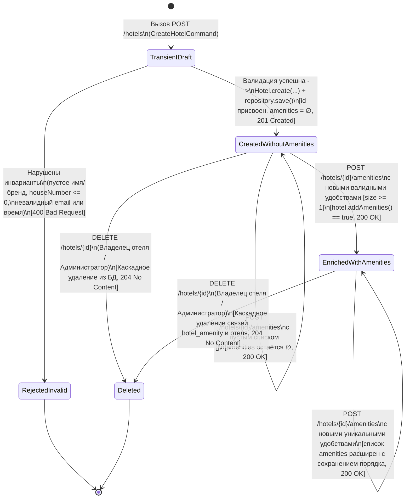

# Спецификация требований к программному обеспечению (SRS)
**Проект:** `property-view-api` (Система управления каталогом отелей и аналитики)  
**Версия:** 1.0  
**Дата:** 2026-10-26

## 1. Бизнес-требования (Business Requirements)

### 1.1. Назначение системы и решаемая проблема
В гостиничном бизнесе и туристических агрегаторах данные об объектах размещения (адреса, контактные данные, время заезда и выезда, перечень доступных удобств) часто хранятся разрозненно, дублируются из-за различий в регистре и форматировании (например, `"Free WiFi"`, `"free wifi"`, `"Free   WiFi"`) и требуют сложных выборок при поиске и аналитике.

Система **Property View API** решает эту проблему за счёт:
1. Централизованного хранения карточек отелей со строгой валидацией структуры адреса, контактов и времени заезда/выезда.
2. Автоматической нормализации и регистронезависимой дедупликации удобств с сохранением порядка их добавления.
3. Предоставления единого интерфейса многокритериального поиска и построения агрегированных гистограмм в реальном времени без деградации производительности (без проблемы `N+1` SQL-запросов).

### 1.2. Бизнес-цели (Business Goals)
- **BG-01 (Единый каталог и качество данных):** Обеспечить 100% валидацию обязательных атрибутов отеля при создании и исключить дублирование удобств в рамках одного отеля и справочника БД.
- **BG-02 (Быстрый подбор объектов размещения):** Сократить время поиска отелей по комбинации параметров (`name`, `brand`, `city`, `country`, `amenities`) до `< 100 мс` при 95-м перцентиле (`p95`) на типовой нагрузке.
- **BG-03 (Оперативная аналитика каталога):** Предоставить получение сводных гистограмм распределения отелей по брендам, городам, странам и удобствам за один агрегирующий запрос к БД.
- **BG-04 (Переносимость и стандартизация интеграции):** Обеспечить совместимость с OpenAPI 3.0, единый формат ошибок RFC 7807 (`application/problem+json`) и возможность работы поверх H2, PostgreSQL и MySQL без изменения исходного кода.

## 2. Пользовательские требования (User Requirements) и Use Case диаграмма

### 2.1. Перечень пользовательских требований (Use Cases)
1. **UR-01 (UC-01 — Просмотр каталога отелей):** Как **Гость** или **Клиентский сервис**, я хочу получить список всех отелей в кратком формате (`id`, `name`, `description`, отформатированный в одну строку `address`, `phone`), чтобы отобразить витрину каталога.
2. **UR-02 (UC-02 — Просмотр полной карточки отеля):** Как **Гость**, я хочу получить детальную информацию об отеле по его `id` (включая структурированный адрес, email, время заезда/выезда и упорядоченный список удобств), чтобы принять решение о бронировании.
3. **UR-03 (UC-03 — Регистрация нового отеля):** Как **Контент-менеджер (Отельер)**, я хочу зарегистрировать новый отель с указанием названия, бренда, адреса, контактов и времени заезда/выезда, чтобы объект появился в каталоге и получил уникальный `id`.
4. **UR-04 (UC-04 — Добавление удобств к отелю):** Как **Контент-менеджер (Отельер)**, я хочу добавлять удобства к существующему отелю списком строк без риска создания дубликатов, чтобы обогатить карточку отеля актуальной информацией.
5. **UR-05 (UC-05 — Многокритериальный поиск отелей):** Как **Гость**, я хочу искать отели по части названия, бренду, городу, стране и набору требуемых удобств (независимо от регистра символов), чтобы быстро находить подходящие варианты размещения.
6. **UR-06 (UC-06 — Получение аналитических гистограмм):** Как **Аналитик**, я хочу получать количество отелей в разрезе бренда (`brand`), города (`city`), страны (`country`) или удобства (`amenities`), чтобы анализировать покрытие каталога.
7. **UR-07 (UC-07 — Работа с каталогом через веб-интерфейс и Swagger UI):** Как **Пользователь веб-интерфейса**, я хочу просматривать список отелей, фильтровать каталог, просматривать гистограммы и создавать отели через браузер с адаптивной вёрсткой.

### 2.2. Диаграмма вариантов использования (Use Case Diagram)

## 3. Функциональные требования (Functional Requirements)

| ID | Приоритет | Модуль | Описание функционального требования | Связанное UR |
|---|---|---|---|---|
| **FR-01** | High | `presentation` | Все HTTP-эндпоинты REST API и веб-ресурсы приложения должны быть доступны под единым контекстным префиксом `/property-view` на порту `8092` (запросы без префикса возвращают `404 Not Found`). | UR-01..UR-07 |
| **FR-02** | High | `HotelController` | Эндпоинт `GET /property-view/hotels` должен возвращать HTTP `200 OK` и JSON-массив кратких карточек всех отелей (`id`, `name`, `description`, `address`, `phone`), отсортированных по возрастанию `id` (при пустой БД возвращается `[]`). | UR-01 |
| **FR-03** | High | `domain` / `Address` | В кратком представлении отеля (`HotelSummaryResponse`) поле `address` должно форматироваться в единую строку по шаблону: `"{houseNumber} {street}, {city}, {postCode}, {country}"` (например, `"9 Pobediteley Avenue, Minsk, 220004, Belarus"`). | UR-01, UR-03, UR-05 |
| **FR-04** | High | `HotelController` | Эндпоинт `GET /property-view/hotels/{id}` должен возвращать HTTP `200 OK` и полную карточку отеля (`id`, `name`, `description`, `brand`, объект `address`, объект `contacts`, объект `arrivalTime`, массив строк `amenities`). | UR-02 |
| **FR-05** | High | `HotelController` / `GlobalExceptionHandler` | При запросе `GET /property-view/hotels/{id}` или `POST /property-view/hotels/{id}/amenities` с несуществующим `id` система должна возвращать HTTP `404 Not Found` в формате `application/problem+json` с заголовком `"Hotel not found"`. | UR-02, UR-04 |
| **FR-06** | High | `HotelController` | Эндпоинт `POST /property-view/hotels` при валидном теле запроса должен сохранять новый отель в БД с пустым списком удобств, присваивать автоинкрементный `id` (начиная с `1` на пустой БД) и возвращать HTTP `201 Created`, заголовок `Location: .../property-view/hotels/{id}` и краткую карточку отеля. | UR-03 |
| **FR-07** | High | `CreateHotelRequest` | При создании отеля поля `description` (до 4000 символов) и `arrivalTime.checkOut` должны быть необязательными (могут отсутствовать или быть `null`); если `description` состоит только из пробелов, оно нормализуется в `null`. | UR-03 |
| **FR-08** | High | `presentation` / `domain` | При создании отеля поля `name` (<=255), `brand` (<=255), `address.houseNumber` (>0), `address.street` (<=255), `address.city` (<=255), `address.country` (<=255), `address.postCode` (<=32), `contacts.phone` (<=64), `contacts.email` (валидный email, <=255) и `arrivalTime.checkIn` (формат `HH:mm`) являются обязательными; при нарушении возвращается `400 Bad Request` (`application/problem+json`) с картой ошибок `errors`. | UR-03 |
| **FR-09** | High | `ArrivalTimeDto` | Поля времени `arrivalTime.checkIn` и `arrivalTime.checkOut` должны приниматься и сериализоваться в формате `HH:mm` (24-часовой формат `00:00`–`23:59`); при некорректном времени (например, `"25:00"`) или невалидном JSON возвращается `400 Bad Request`. | UR-02, UR-03 |
| **FR-10** | High | `HotelAmenityController` | Эндпоинт `POST /property-view/hotels/{id}/amenities` должен принимать JSON-массив строк (от 0 до 100 элементов, каждая строка не пустая и не длиннее 255 символов), привязывать удобства к отелю и возвращать HTTP `200 OK` с полной обновлённой карточкой отеля (`HotelDetailsResponse`). | UR-04 |
| **FR-11** | High | `Amenity` / `Hotel` | При добавлении удобств к отелю названия должны очищаться от начальных/конечных пробелов, множественные пробелы внутри названия заменяются одним пробелом, дубликаты игнорируются без чувствительности к регистру (`"Free WiFi"` и `"free wifi"` считаются одним удобством), сохраняется первое написание и порядок добавления. | UR-04 |
| **FR-12** | High | `SearchController` | Эндпоинт `GET /property-view/search` должен поддерживать фильтрацию по параметрам `name` (регистронезависимое вхождение подстроки), `brand`, `city`, `country` (регистронезависимое точное совпадение) и `amenities` (отель должен содержать **все** указанные удобства, регистронезависимо). | UR-05 |
| **FR-13** | Medium | `SearchController` | В `GET /property-view/search` все переданные параметры объединяются по логическому `И` (`AND`); параметр `amenities` может передаваться как повторно (`?amenities=A&amenities=B`), так и через запятую (`?amenities=A,B`); вызов без параметров возвращает все отели. | UR-05 |
| **FR-14** | Medium | `HotelSpecifications` | Поиск по полю `name` в `GET /property-view/search` должен экранировать спецсимволы SQL `LIKE` (`%`, `_`, `\`), трактуя их как обычные литералы, а не подстановочные знаки. | UR-05 |
| **FR-15** | High | `HistogramController` | Эндпоинт `GET /property-view/histogram/{param}` должен принимать параметр группировки `brand`, `city`, `country` или `amenities` (без учёта регистра, например `/histogram/City` или `/histogram/AMENITIES`) и возвращать HTTP `200 OK` с JSON-объектом `{"ключ": количество}`, где ключи отсортированы по алфавиту. | UR-06 |
| **FR-16** | Medium | `HistogramController` | При вызове `GET /property-view/histogram/{param}` с неподдерживаемым параметром (например, `/histogram/stars`) система должна возвращать HTTP `400 Bad Request` (`application/problem+json`) с перечислением допустимых значений: `brand, city, country, amenities`. | UR-06 |
| **FR-17** | Medium | `Security` / `Presentation` | При включённом режиме защиты модифицирующих операций (`propertyview.security.enabled=true`) запросы на изменение данных или в закрытую административную зону (`/property-view/admin/**`, удаление/редактирование чужого отеля по `X-Owner-Id`) без авторизации или с чужим идентификатором владельца (IDOR) должны отклоняться с кодами `401 Unauthorized` / `403 Forbidden`. | UR-03, UR-04 |
| **FR-18** | Medium | `Web UI` / `OpenAPI` | Система должна предоставлять интерактивную спецификацию OpenAPI (`/property-view/v3/api-docs`), Swagger UI (`/property-view/swagger-ui.html`) и клиентский веб-интерфейс (`/property-view/index.html`) для просмотра каталога, фильтрации, добавления отелей и отображения гистограмм. | UR-07 |

## 4. Нефункциональные требования (Non-Functional Requirements)

| ID | Категория | Описание нефункционального требования (с измеримым критерием) |
|---|---|---|
| **NFR-01** | Производительность (Время отклика) | При параллельной работе до 50 виртуальных пользователей 95-й перцентиль времени отклика (`p95`) для операций чтения (`GET /hotels`, `GET /hotels/{id}`, `GET /search`, `GET /histogram/{param}`) не должен превышать `100 мс`, а для операций записи (`POST /hotels`, `POST /hotels/{id}/amenities`) — `200 мс` при доле ошибок `< 1%`. |
| **NFR-02** | Эффективность работы с БД (Отсутствие N+1) | Выполнение операций получения списка (`findAllOverviews`), поиска с фильтром по удобствам (`search`), получения деталей отеля (`findById`) и построения каждой гистограммы (`countBy*`) должно генерировать ровно **1 подготовленный SQL-запрос (`PreparedStatement`)** к базе данных независимо от количества отелей и удобств в выборке. |
| **NFR-03** | Архитектурная целостность | Пакет `domain` не должен иметь зависимостей от `application`, `infrastructure`, `presentation`, Spring или Jakarta Persistence; пакет `application` должен зависеть только от `domain` и стандартной библиотеки Java. Нарушения блокируют сборку через тесты ArchUnit. |
| **NFR-04** | Информационная безопасность и обработка ошибок | Ни один ответ API со статусом `4xx` или `5xx` не должен раскрывать стек вызовов Java (`stacktrace`), внутренние пути файловой системы сервера или текст SQL-запросов; все ошибки возвращаются строго в формате RFC 7807 (`application/problem+json`). |
| **NFR-05** | Переносимость СУБД и управление схемой | Схема БД должна создаваться и изменяться исключительно миграциями Liquibase без использования платформозависимого нативного SQL и успешно проходить валидацию Hibernate (`ddl-auto: validate`) на H2, PostgreSQL 16 и MySQL 8.4. |
| **NFR-06** | Наблюдаемость и логирование | Все ключевые бизнес-операции (создание отеля, добавление удобств, поиск, построение гистограмм) и ошибки валидации/доступа/сервера должны логироваться через SLF4J с указанием уровня (`INFO`/`WARN`/`ERROR`) и идентификаторов сущностей. |
| **NFR-07** | Тестовое покрытие и качество кода | Покрытие продуктового кода автоматизированными тестами (за исключением конфигураций, сгенерированных мапперов и точки входа) по метрике инструкций/линий JaCoCo должно составлять **не менее 70%**, а код должен проходить статический анализ линтером без критических нарушений. |

## 5. Верификация требований

### 5.1. Переформулирование нетестируемых (размытых) формулировок
При первичном анализе были выявлены формулировки, для которых невозможно однозначно задать критерий прохождения проверки. Они были переписаны в измеримом виде:

| Первоначальная (неверифицируемая) формулировка | Причина неверифицируемости | Исправленная верифицируемая формулировка в SRS |
|---|---|---|
| *«Поиск отелей должен работать быстро и удобно для пользователя»* | Нет численных порогов времени отклика, объёма нагрузки и правил сопоставления строк. | **FR-12 + NFR-01:** Поиск `GET /search` сопоставляет `name` по подстроке и `brand/city/country/amenities` без учёта регистра; при 50 одновременных пользователях `p95 <= 100 мс`. |
| *«База данных должна работать эффективно без лишних запросов»* | Понятие «лишние запросы» субъективно без точной метрики Hibernate Statistics. | **NFR-02:** Каждая операция чтения (`findAllOverviews`, `search`, `findById`, `countBy*`) выполняет ровно `1` SQL `PreparedStatement` на выборке из >=10 отелей с удобствами (`QueryCountTest`). |
| *«Код проекта должен иметь хорошую модульную архитектуру и высокое покрытие тестами»* | Не заданы правила зависимостей между пакетами и минимальный порог покрытия. | **NFR-03 + NFR-07:** Зависимости пакетов проверяются ArchUnit (`ArchitectureTest`), а покрытие инструкций по JaCoCo составляет `>= 70%`. |

### 5.2. Матрица верификации требований и сверка с работающим приложением

| ID | Способ проверки | Инструмент / Тест верификации | Статус в приложении | Расхождения / Дефекты (`ISSUES.md`) |
|---|---|---|---|---|
| **FR-01** | Автоматизированный E2E-тест | `HotelApiEndToEndTest#everythingLivesUnderThePropertyViewPrefix` | Выполнено | Нет расхождений |
| **FR-02** | Интеграционный и E2E-тест | `HotelControllerTest#getAllReturnsBriefList`, `HotelApiEndToEndTest` | Выполнено (с замечанием) | [DEF-05](../ISSUES.md): Отсутствует пагинация при большом объёме каталога |
| **FR-03** | Модульный тест | `AddressTest#formatsSingleLineAsInTask`, `HotelSummaryTest` | Выполнено | Нет расхождений |
| **FR-04** | Интеграционный и E2E-тест | `HotelControllerTest#getByIdReturnsFullStructure`, `HotelApiEndToEndTest` | Выполнено | Нет расхождений |
| **FR-05** | Интеграционный тест | `HotelControllerTest#getByIdReturns404ProblemForUnknownHotel` | Выполнено | Нет расхождений |
| **FR-06** | Интеграционный и E2E-тест | `HotelControllerTest#createReturns201WithLocationAndSummary` | Выполнено | Нет расхождений |
| **FR-07** | Интеграционный тест | `HotelControllerTest#createAcceptsMissingOptionalFields` | Выполнено | Нет расхождений |
| **FR-08** | Модульный и интеграционный тест | `HotelControllerTest#createRejectsInvalidFieldsWithProblemDetail` | Частичное расхождение | [DEF-04](../ISSUES.md): Поле `contacts.phone` принимает любую непустую строку (например, `"1"`) без проверки телефонного формата |
| **FR-09** | Интеграционный тест | `HotelControllerTest#createRejectsMalformedTimeAndBrokenJson` | Частичное расхождение | [DEF-04](../ISSUES.md): Не проверяется бизнес-условие соотношения `checkIn` и `checkOut` (допускается `checkIn == checkOut`) |
| **FR-10** | Интеграционный тест | `HotelAmenityControllerTest` | Выполнено | Нет расхождений |
| **FR-11** | Модульный и БД-тест | `AmenityTest`, `HotelRepositoryAdapterTest#reusesAmenityRowsCaseInsensitively` | Частичное расхождение | [DEF-01](../ISSUES.md): При конкурентных запросах с новым удобством возникает `DataIntegrityViolationException` (`uq_amenity_normalized_name`) |
| **FR-12** | Интеграционный БД и E2E-тест | `HotelRepositoryAdapterTest`, `HotelApiEndToEndTest` | Частичное расхождение | [DEF-02](../ISSUES.md): В критериях поиска множественные пробелы внутри `name`/`city`/`brand` не схлопываются в отличие от `Amenity` |
| **FR-13** | Интеграционный и E2E-тест | `SearchControllerTest`, `HotelApiEndToEndTest` | Выполнено | Нет расхождений |
| **FR-14** | Интеграционный БД-тест | `HotelRepositoryAdapterTest#searchTreatsLikeWildcardsLiterally` | Выполнено | Нет расхождений |
| **FR-15** | Модульный и E2E-тест | `HistogramControllerTest`, `HistogramServiceTest` | Частичное расхождение | [DEF-03](../ISSUES.md): В профиле MySQL ключи гистограммы, отличающиеся только регистром, сливаются из-за collation по умолчанию |
| **FR-16** | Модульный и интеграционный тест | `HistogramParamTest`, `HistogramControllerTest#unknownParameterGives400WithSupportedList` | Выполнено | Нет расхождений |
| **FR-17** | Интеграционный тест безопасности | `SecurityIntegrationTest`, Postman Security Suite | Выполнено | Доработано фильтром контроля доступа и проверки владельца (`X-Owner-Id` / `Authorization`) |
| **FR-18** | E2E и UI-тестирование (Playwright) | `HotelApiEndToEndTest#swaggerAndOpenApiAreAvailable`, UI-тесты | Выполнено | Нет расхождений |
| **NFR-01** | Нагрузочное тестирование | Locust (`load-tests/locustfile.py`) | Выполнено (до точки деградации) | При стресс-тесте с конкурентной записью удобств проявляется [DEF-01](../ISSUES.md) |
| **NFR-02** | Интеграционный тест Hibernate Statistics | `QueryCountTest` | Выполнено | Нет расхождений (ровно 1 запрос на операцию) |
| **NFR-03** | Архитектурный тест | `ArchitectureTest` (ArchUnit) | Выполнено | Нет расхождений |
| **NFR-04** | Интеграционный тест безопасности | `GlobalExceptionHandler`, `SecurityIntegrationTest` | Выполнено | Нет расхождений |
| **NFR-05** | Интеграционный тест миграций | `HotelRepositoryAdapterTest#liquibaseMigrationsAreApplied` | Выполнено | Нет расхождений |
| **NFR-06** | Инспекция логов и автотест | Логирование SLF4J в сервисах и `GlobalExceptionHandler` | Выполнено | Доработано структурным логированием операций |
| **NFR-07** | Анализ покрытия и статический анализ | JaCoCo (`mvn verify`) + Checkstyle | Выполнено | Покрытие > 90% (порог >= 70% выполнен) |

## 6. Диаграмма состояний сущности `Hotel` (State Diagram)

Основной сущностью системы с жизненным циклом является агрегат **`Hotel`** (`com.propertyview.domain.model.Hotel`). В процессе работы системы сущность проходит через валидацию входной команды, транзиентное доменное состояние, персистентное состояние без удобств, обогащённое удобствами состояние и (при удалении/архивации администратором) архивное/удалённое состояние.

### Описание состояний и переходов сущности `Hotel`

| Состояние | Инварианты состояния | Событие / Условие перехода в состояние | Доступные операции |
|---|---|---|---|
| **`TransientDraft`** (Начальное транзиентное) | `id == null`, входные данные получены в `CreateHotelCommand` | Поступление HTTP-запроса `POST /property-view/hotels` | Проверка доменных предусловий (`Preconditions`) и Bean Validation |
| **`RejectedInvalid`** (Конечное неуспешное) | Объект не создан в БД | Не пройдена валидация обязательных полей или формата `HH:mm` / `@Email` | Возврат `400 Bad Request` (`ProblemDetail`) |
| **`CreatedWithoutAmenities`** (Создан без удобств) | `id != null`, `amenities.isEmpty() == true`, запись в таблице `hotel` существует, записей в `hotel_amenity` нет | Успешное выполнение `CreateHotelService#create` и сохранение в `HotelRepositoryAdapter#save` | Чтение (`GET /hotels`, `GET /hotels/{id}`), поиск (`GET /search`), учёт в гистограммах `brand/city/country`, добавление удобств (`POST /hotels/{id}/amenities`), удаление (`DELETE /hotels/{id}`) |
| **`EnrichedWithAmenities`** (Обогащён удобствами) | `id != null`, `amenities.size() >= 1`, удобства нормализованы, дедуплицированы без учёта регистра и упорядочены по `sort_order` | Вызов `POST /property-view/hotels/{id}/amenities` с непустым списком валидных удобств | Полный доступ во всех выборках, поиск по фильтру `?amenities=...`, учёт во всех 4 гистограммах (включая `/histogram/amenities`), идемпотентное дообогащение удобствами, удаление |
| **`Deleted`** (Конечное — удалён из каталога) | Запись в `hotel` и связанные записи в `hotel_amenity` удалены (`ON DELETE CASCADE`), `findById(id)` возвращает `Optional.empty()` | Вызов `DELETE /property-view/hotels/{id}` авторизованным владельцем отеля | Любое последующее обращение по `id` возвращает `404 Not Found` |
